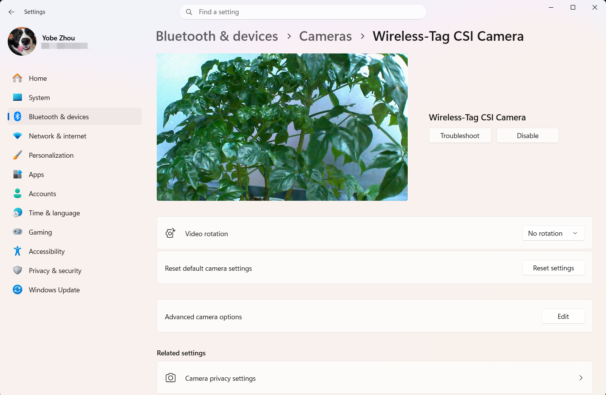

| Supported Targets | WT9932P4-TINY | WT9932P4C61-TINY | WT9932P4X-TINY | WT9932S31-TINY |
| --- | --- | --- | --- | --- |

# USB Device UVC Camera Example

WT9932P4-TINY uses ESP32-P4 v1.x; WT9932P4X-TINY uses v3.x. They share peripheral wiring but require different firmware. Select the actual board with `idf.py set-board`; see the [revision and build notes](../../../components/wt_bsp/boards/WT9932P4X-TINY/README.md).

This example exposes the SC2336 MIPI CSI camera connected to WT9932P4-TINY, WT9932P4X-TINY, or WT9932P4C61-TINY as a High-Speed USB UVC MJPEG camera. A USB host can open the stream with a standard camera application or OBS without a board-specific camera driver.

`wt_bsp_init()` prepares independent CSI/camera and UVC objects. The application
then calls `camera_uvc_start()` from `examples/common_components/wt_camera_uvc/`.
That application component chooses the frame source, performs JPEG encoding when
needed and supplies buffers/callbacks to the public UVC API. The BSP does not
connect a camera to USB automatically. The application uses `wt_bsp.h`, without
private board headers or duplicated hardware pin definitions.

## WT9932S31-TINY (DVP)

Use ESP-IDF v6.1 or later. Flash and monitor through J2; connect J1 to the UVC
host and the camera to the DVP FPC. The P4 CSI/FUSB/HUSB and IO0 instructions
below apply only to the P4 boards.

```shell
WT_BSP_BOARD=WT9932S31-TINY idf.py --preview -C examples/camera/usb_device_uvc set-board
idf.py --preview -C examples/camera/usb_device_uvc build
idf.py --preview -C examples/camera/usb_device_uvc menuconfig
```

Select the module and capture mode under `WT BSP → Camera sensor`, then rebuild and flash:

| Camera profile | UVC mode | Encoding |
| --- | --- | --- |
| GC2145 / CKS-K210-GC3.1 720p (example default) | MJPEG 1280×720 at 30 FPS, Isochronous | UYVY → S31 hardware JPEG, quality 60 |
| GC2145 / CKS-K210-GC3.1 UXGA | MJPEG 1600×1200, nominal 8 FPS, Bulk | UYVY → S31 hardware JPEG |
| OV3660 | MJPEG 640×480, nominal 25 FPS, Isochronous | Sensor-native JPEG |

Both modules use SCCB address `0x3c`. The driver probes only the selected
sensor. The 720p mode uses a centered sensor window and a 24 MHz XCLK. It
advertises a single 30 FPS interval over High-Speed USB isochronous transfers.
UXGA uses a 20 MHz XCLK
and divides the sensor output clock by two.

The USB product name is `Wireless-Tag Camera`. The 720p prototype delivered
5,400 frames to macOS over 180 seconds. Check the host's UVC decode count when
measuring source FPS because the capture API can repeat frames to meet the
requested rate. Existing builds keep their saved camera selection. Choose 720p
in menuconfig or use a fresh build directory to apply the new default.

On S31,
`wt_bsp_get_csi()` returns `NULL`; the application uses `wt_bsp_get_camera()`
instead. DVP acquisition and sensor/JPEG handling live in `features/camera`;
the board supplies wiring, selected sensor settings and buffer budgets.
Check both BSP initialization and `camera_uvc_start()` results. Standalone
CDC and UVC cannot independently own the same USB controller; a composite device
requires the application-provided USB profile.

The reference project's GC2145 UXGA right-edge colored line, Windows Camera support
and OV3660 image tuning still require hardware checks. The P4 screenshot below
is not S31 validation. See the [board notes](../../../components/wt_bsp/boards/WT9932S31-TINY/README.md).

## Hardware

1. Connect the SC2336 camera to the board MIPI CSI connector.
2. Use FUSB to flash and monitor the ESP32-P4 firmware.
3. After the firmware starts, connect HUSB to the computer.

IO0 is connected to the camera PWDN/LDO/RESET control path on all supported P4 boards. The BSP drives IO0 high before detecting the camera.

## Build

After loading an ESP-IDF v6.0.0 or later environment, select the board and then build from the repository root:

```shell
WT_BSP_BOARD=WT9932P4C61-TINY idf.py \
    -C examples/camera/usb_device_uvc \
    -B build-usb-device-uvc-p4c61 \
    set-board
idf.py \
    -C examples/camera/usb_device_uvc \
    -B build-usb-device-uvc-p4c61 \
    build
```

For WT9932P4-TINY, select the corresponding board configuration:

```shell
WT_BSP_BOARD=WT9932P4-TINY idf.py \
    -C examples/camera/usb_device_uvc \
    -B build-usb-device-uvc-p4 \
    set-board
idf.py \
    -C examples/camera/usb_device_uvc \
    -B build-usb-device-uvc-p4 \
    build
```

Alternatively, enter the example directory, run `idf.py set-board`, select either supported board, and then run `idf.py build`.

The default configuration uses:

- High-Speed USB Device
- UVC MJPEG
- 1024x600 at 30 FPS
- JPEG quality 80
- Stream setup and failures are reported by the application

Enable the independent features under `WT BSP -> Feature selection`: USB UVC
plus CSI for P4, or JPEG camera capture for S31. Enabling UVC alone does not select
a camera or start streaming. The example's sensor-to-UVC profiles live under
`Camera UVC application`.

## Expected Result

After both BSP initialization and the application's bridge start succeed, the
USB host can enumerate `Wireless-Tag CSI Camera` on P4. Host stream requests are
handled by the application bridge, which obtains camera frames and supplies JPEG
data to the independent UVC feature.

### Expected Warnings

The following warnings can appear during normal operation and do not indicate a camera or UVC failure:

```text
W (...) board: Display device not found at address: 0x28
W (...) board: Touch device not found at address: 0x55
```

The BSP scans the shared I2C bus for the optional display, touch controller, and camera. These two warnings are expected when only the SC2336 camera is connected. Camera initialization can continue as long as the camera is detected at address `0x30`.

```text
W (...) usb_phy: Using UTMI PHY instead of requested internal PHY
```

ESP-IDF selects the ESP32-P4 UTMI PHY for High-Speed USB Device operation. This compatibility fallback is expected and does not reduce the configured UVC speed.

On ESP32-P4 revisions that support ISP AWB subwindows, a 1024x600 stream can also produce the following warning repeatedly while streaming. This example suppresses the `ISP_AWB` tag at runtime by default; the warning may still appear if that filter is removed or the BSP is used by another application:

```text
W (...) ISP_AWB: subwindow size (1024 x 600) is not divisible by AWB subwindow blocks grid (5 x 5).
             Resolution will be floored to the nearest divisible value.
```

This warning applies only to the ISP automatic white balance statistics window. ESP-IDF aligns that internal window from 1024x600 to 1020x600 because its width must be divisible by the 5x5 AWB grid. Camera capture, JPEG encoding, and USB UVC output remain at 1024x600. With `esp_video` 2.3.x, AWB parameters can be reconfigured for each frame, so the same non-fatal warning may be printed at approximately the stream frame rate.

Do not change the UVC resolution to 1020x600 only to suppress this warning. If the host receives a stable image and the log reports that CSI, UVC, and streaming started successfully, no action is required.

### Windows Preview

On Windows 11, open **Settings > Bluetooth & devices > Cameras**, select `Wireless-Tag CSI Camera`, and view the live preview as shown below:



> This is a historical hardware screenshot from before the camera/UVC layering change and before the custom interface name was applied. The intended P4 interface name is `Wireless-Tag CSI Camera`; this migration did not produce a new hardware screenshot. See the [validation record](../../../docs/bsp-validation.md) for its build/emulator coverage.
>
> The screenshot above was captured with WT9932P4C61-TINY. This board uses an ESP32-P4 v3.x chip, and the camera image is processed by the ISP. WT9932P4-TINY uses an ESP32-P4 v1.x chip without ISP processing in this example, so its displayed image quality may be lower.

## Notes

- The application bridge owns CSI capture while it is active. Stop it before starting a different CSI consumer or calling `wt_bsp_deinit()`.
- A `NULL` result from `wt_bsp_get_csi()` means that the camera is disabled, missing, or failed to initialize.
- Disabling `CONFIG_WT_BSP_ENABLE_USB_DEVICE_UVC` removes the UVC feature; disabling CSI or camera capture independently removes that frame source.
