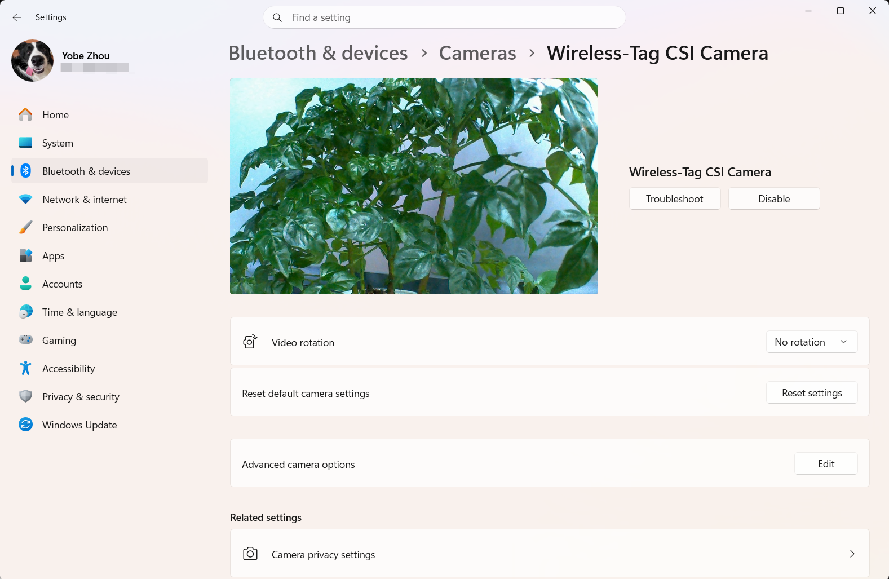

| 支持目标 | WT9932P4-TINY | WT9932P4C61-TINY | WT9932P4X-TINY | WT9932S31-TINY |
| --- | --- | --- | --- | --- |

# USB Device UVC 摄像头示例

WT9932P4-TINY 对应 ESP32-P4 v1.x，WT9932P4X-TINY 对应 v3.x；两者外设接线相同，固件不能混用。请在 `idf.py set-board` 中选择实际板型，详见[版本与构建说明](../../../components/wt_bsp/boards/WT9932P4X-TINY/README.md)。

本示例支持 P4 板卡的 SC2336 MIPI CSI 摄像头和 S31 板卡的 GC2145/OV3660 DVP 摄像头，将其模拟为 High-Speed USB UVC MJPEG 摄像头。电脑无需专用驱动即可通过系统相机、OBS 等兼容 UVC 的软件获取画面。

`wt_bsp_init()` 分别准备独立的 CSI/相机和 USB UVC 对象，应用随后显式调用
`examples/common_components/wt_camera_uvc/` 提供的 `camera_uvc_start()`。
该应用组件选择帧源、按需编码 JPEG，并向公共 UVC API 提供缓冲和回调。
应用层通过 `wt_bsp.h` 获取资源，不直接使用板级私有头文件或引脚定义。

## WT9932S31-TINY (DVP)

S31 使用 ESP-IDF v6.1 或以上版本。J2 用于烧录/日志，J1 为 UVC USB 接口；
摄像头连接 DVP FPC。该板不使用下面 P4 专属的 CSI、FUSB/HUSB 或 IO0 控制步骤。

```shell
WT_BSP_BOARD=WT9932S31-TINY idf.py --preview -C examples/camera/usb_device_uvc set-board
idf.py --preview -C examples/camera/usb_device_uvc build
idf.py --preview -C examples/camera/usb_device_uvc menuconfig
```

在 `WT BSP → Camera sensor` 选择模组和采集模式，随后重新构建和烧录：

| 摄像头配置 | UVC 模式 | 编码路径 |
| --- | --- | --- |
| GC2145 / CKS-K210-GC3.1 720p（本示例默认） | MJPEG 1280×720，30 FPS，Isochronous | UYVY → S31 硬件 JPEG，质量 60 |
| GC2145 / CKS-K210-GC3.1 VGA | MJPEG 640×480，标称 30 FPS，Isochronous | RGB565 → S31 硬件 JPEG，质量 60 |
| GC2145 / CKS-K210-GC3.1 UXGA | MJPEG 1600×1200，标称 8 FPS，Bulk | UYVY → S31 硬件 JPEG |
| OV3660 | MJPEG 640×480，标称 25 FPS，Isochronous | 传感器原生 JPEG |

两款模组地址均为 `0x3c`，仅探测菜单选择的型号。720p 使用传感器居中裁切和 24 MHz XCLK，
在高速 USB 等时传输中只公布一个 30 FPS 档位。VGA 使用 25 MHz XCLK 和全视野传感器时序。
UXGA 使用 20 MHz XCLK 和输出时钟二分频。

USB 产品名为 `Wireless-Tag Camera`。720p 实验固件在 macOS 上 180 秒收到 5,400 帧。
验证源端帧率时，请核对主机 UVC 解码计数，采集 API 可能通过重复帧满足请求帧率。
已有构建会保留保存的相机选项。可在 menuconfig 中选 720p，或使用新的构建目录应用默认值。
S31 的 `wt_bsp_get_csi()` 返回 `NULL`，应用通过 `wt_bsp_get_camera()` 获取相机。
DVP 采集、传感器模式和 JPEG 处理位于 `features/camera`；板级提供接线、型号参数和缓冲预算。
需要分别检查 `wt_bsp_init()` 和 `camera_uvc_start()` 的返回值。
UVC 和独立 USB CDC 不能各自占用同一个 USB 控制器；复合设备需由应用提供 USB profile。

参考工程记录的 GC2145 UXGA 右侧细彩点竖线、Windows 原生相机兼容性及 OV3660
画质微调仍需实板复验。下面的 P4 截图不是 S31 验证结果。详见
[板卡说明](../../../components/wt_bsp/boards/WT9932S31-TINY/README.md)。

## P4 硬件连接

1. 将 SC2336 摄像头连接到开发板 MIPI CSI 接口。
2. 使用 FUSB 接口烧录 ESP32-P4 固件和查看串口日志。
3. 固件启动后，将 HUSB 接口连接到电脑。

三款 P4 板卡的 IO0 都连接到摄像头 PWDN/LDO/RESET 控制路径，BSP 会在检测摄像头前自动将 IO0 拉高。

## P4 编译

加载 ESP-IDF v6.0.0 或以上版本的环境后，在仓库根目录运行：

```shell
WT_BSP_BOARD=WT9932P4C61-TINY idf.py \
    -C examples/camera/usb_device_uvc \
    -B build-usb-device-uvc-p4c61 \
    set-board
idf.py \
    -C examples/camera/usb_device_uvc \
    -B build-usb-device-uvc-p4c61 \
    build
```

使用 WT9932P4-TINY 时选择对应板级配置：

```shell
WT_BSP_BOARD=WT9932P4-TINY idf.py \
    -C examples/camera/usb_device_uvc \
    -B build-usb-device-uvc-p4 \
    set-board
idf.py \
    -C examples/camera/usb_device_uvc \
    -B build-usb-device-uvc-p4 \
    build
```

也可以进入示例目录，执行 `idf.py set-board` 并选择任一受支持板卡，然后运行 `idf.py build`。

默认配置为：

- High-Speed USB Device
- UVC MJPEG
- 1024x600 @ 30 FPS
- JPEG 压缩质量 80
- 推流启动和故障通过应用日志报告

在 `WT BSP -> Feature selection` 中独立启用 USB UVC，以及 P4 的 CSI 或 S31 的
JPEG 相机采集。单独启用 UVC 不会选择摄像头或自动推流。
传感器到 UVC 的应用配置位于 `Camera UVC application`。

## P4 运行效果

BSP 初始化和应用桥接启动都成功后，P4 的 USB 主机会枚举出名为
`Wireless-Tag CSI Camera` 的摄像头。主机请求推流时，应用桥接从相机取得帧并向独立
UVC feature 提供 JPEG 数据。应用成功日志为
`Application camera-to-UVC bridge is ready. Connect USB OTG to the host.`。

### 预期警告

正常运行期间可能出现以下警告，它们不表示摄像头或 UVC 功能异常：

```text
W (...) board: Display device not found at address: 0x28
W (...) board: Touch device not found at address: 0x55
```

BSP 会扫描共享 I2C 总线上的可选显示屏、触摸控制器和摄像头。仅连接 SC2336 摄像头时，未检测到显示屏和触摸控制器属于正常现象。只要在地址 `0x30` 检测到摄像头，摄像头初始化就可以继续。

```text
W (...) usb_phy: Using UTMI PHY instead of requested internal PHY
```

ESP-IDF 会为 ESP32-P4 的 High-Speed USB Device 模式选择 UTMI PHY。这是预期的兼容处理，不会降低配置的 UVC 速度。

在支持 ISP AWB 子窗口的 ESP32-P4 芯片版本上，使用 1024x600 视频流时还可能在推流期间重复出现以下警告。本示例默认会在运行时屏蔽 `ISP_AWB` tag；如果移除该过滤设置，或在其他应用中使用 BSP，则仍可能看到该警告：

```text
W (...) ISP_AWB: subwindow size (1024 x 600) is not divisible by AWB subwindow blocks grid (5 x 5).
             Resolution will be floored to the nearest divisible value.
```

该警告仅影响 ISP 自动白平衡的内部统计窗口。由于窗口宽度必须能被 5x5 AWB 网格整除，ESP-IDF 会将内部统计窗口从 1024x600 对齐为 1020x600。摄像头采集、JPEG 编码和 USB UVC 输出仍保持 1024x600。使用 `esp_video` 2.3.x 时，AWB 参数可能逐帧重新配置，因此同一条非致命警告可能按接近视频帧率的频率重复打印。

不要仅为了消除该警告而把 UVC 分辨率修改为 1020x600。如果电脑能够稳定接收画面，并且日志显示 CSI、UVC 和视频流均已成功启动，则不需要处理该警告。

### Windows 查看效果

在 Windows 11 中打开 **设置 > 蓝牙和设备 > 摄像头**，选择 `Wireless-Tag CSI Camera`，即可查看如下图所示的实时画面：



> 这是 camera/UVC 分层调整前、且自定义接口名称生效前的历史实板截图。P4 的预期接口名为 `Wireless-Tag CSI Camera`；本次迁移未重新拍摄实板画面，构建和模拟器覆盖见[验证记录](../../../docs/bsp-validation.md)。
>
> 注意：上图使用 WT9932P4C61-TINY 开发板拍摄。该开发板使用 ESP32-P4 v3.x 芯片，摄像头画面经过 ISP 处理。WT9932P4-TINY 使用 ESP32-P4 v1.x 芯片，本示例不进行 ISP 处理，因此显示效果会相对差一些。

## 说明

- 应用桥接运行时拥有 CSI 采集；启动其他 CSI 消费者或调用 `wt_bsp_deinit()` 前，先成功调用 `camera_uvc_stop()`。
- P4 的 `wt_bsp_get_csi()` 返回 `NULL` 时表示摄像头未启用、未检测到或初始化失败。
- 关闭 `CONFIG_WT_BSP_ENABLE_USB_DEVICE_UVC` 会移除 UVC feature；CSI 和相机采集可独立关闭。
